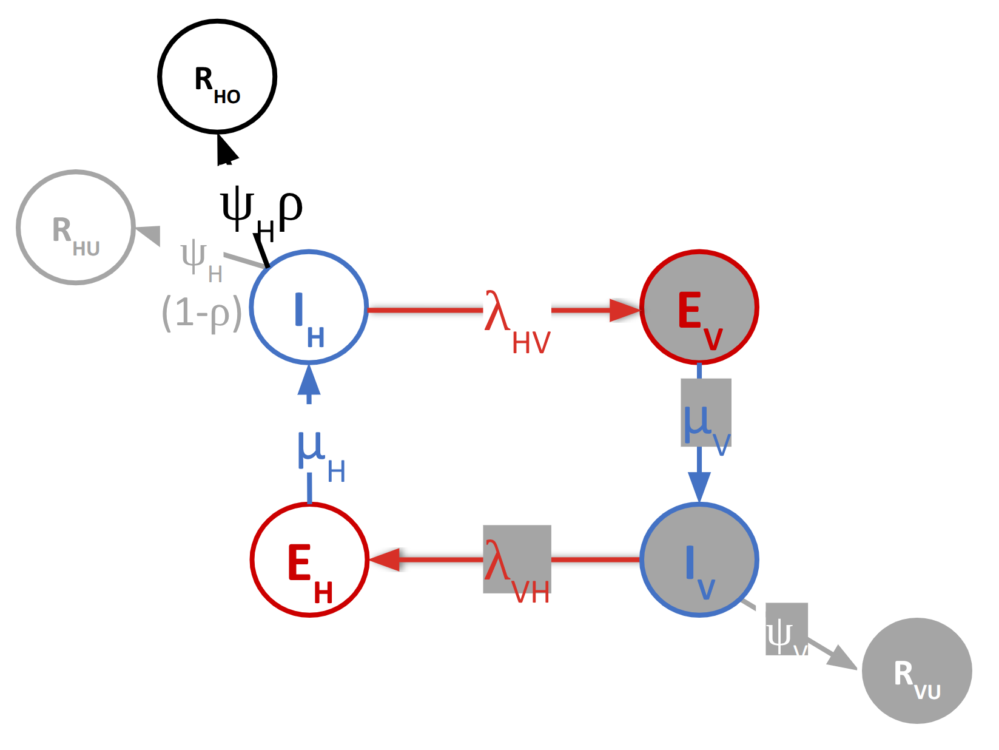

# BDEIVH · Phylodynamic inference for Oropouche virus

Estimate vector-mediated transmission from a dated Oropouche virus (OROV) phylogeny and a human genomic sampling probability. 
The repository pairs the Birth–Death Exposed–Infectious Vector–Human (BDEIVH) model with a convolutional neural network adapted from [PhyloCNN](https://github.com/manolofperez/phyloCNN). 
The pretrained estimator accepts a single cluster with 30–350 sampled tips and returns six epidemiological estimates. It can also repeat inference as samples accumulate over time.

## Associated manuscript

Ighor Arantes, Gonzalo Bello, Felipe Gomes Naveca, Edson Delatorre, Antonio Silva Lima Neto, Sebastian Duchene and Anna Zhukova. *Deep Learning-based Phylodynamic Inference of Oropouche Virus Transmission Dynamics in Brazil Between 2023 and 2025*. 

## BDEIVH model

The Birth-Death Exposed-Infectious Vector-Human (BDEIVH) model is a special case of the Multi-Type Birth-Death model [[Stadler _et al._ 2013]](https://royalsocietypublishing.org/doi/10.1098/rstb.2012.0198).
It represents exposed (E) and infectious (I) states in humans (H) and vectors (V), infected with an arbovirus (e.g., Oropouche virus). An infectious human can infect vectors, and an infectious vector can infect humans. 
The viruses from infected humans may get sampled and used to reconstruct a time-scaled phylogenetic tree (to be used as a proxy of the observed transmission tree).



The BDEIVH model has 4 infected states:
* E<sub>V</sub>, exposed vector, i.e. infected but not yet infectious
* I<sub>V</sub>, infectious vector
* E<sub>H</sub>, exposed human, i.e. infected but not yet infectious
* I<sub>H</sub>, infectious human

and 3 removed states (i.e., that cannot transmit anymore):
* R<sub>VU</sub>, unobserved removed vector, i.e., dead vector with virus unsampled
* R<sub>HU</sub>, unobserved removed human, i.e., the human stopped transmitting further but their virus was not sampled
* R<sub>HO</sub>, observed removed human, i.e., the human stopped transmitting further and their virus sampled -- this state corresponds to the tips in the input tree

It has 2 non-zero state transition rate parameters:
* μ<sub>V</sub> -- transition rate from state E<sub>V</sub> to state I<sub>V</sub>, corresponding to the incubation in vectors
* μ<sub>H</sub> -- transition rate from state E<sub>H</sub> to state I<sub>H</sub>, corresponding to the incubation in humans

It has 2 non-zero transmission rate parameters:
* λ<sub>VH</sub> -- transmission rate from state I<sub>V</sub> (donor) to state E<sub>H</sub> (recipient), corresponding to the vector-to-human transmission
* λ<sub>HV</sub> -- transmission rate from state I<sub>H</sub> (donor) to state E<sub>V</sub> (recipient), corresponding to the human-to-vector transmission

It also has 2 non-zero removal (becoming non-infectious) rate parameters:
* ψ<sub>V</sub> -- removal rate of state V<sub>I</sub>, corresponding to death or recovery (i.e., inability to transmit further) of infectious vectors, i.e., a state change from I<sub>V</sub> to R<sub>VU</sub>
* ψ<sub>H</sub> -- removal rate of state H<sub>I</sub>, corresponding to recovery, self-isolation or death (i.e., inability to transmit further) of infectious humans, i.e., a state change from I<sub>H</sub> to R<sub>HU</sub> or R<sub>HO</sub>, according to the sampling probability (see below).

Finally, it has one non-zero sampling probability upon removal parameter:
* ρ<sub>H</sub> -- probability to sample the pathogen of a human upon removal  (leading to an observed removed state R<sub>HO</sub>)


Using these probabilities, one can calculate the equilibrium frequencies of the model's states, 
where 0 ≤ π<sub>j</sub> ≤ 1, Σ<sub>j</sub>π<sub>j</sub> = 1, and j ∈ {V<sub>E</sub>, V<sub>I</sub>, H<sub>E</sub>, H<sub>I</sub>}. 
We can also define the equilibrium frequency of humans and vectors as:
* π<sub>H</sub>=π<sub>H<sub>E</sub></sub> + π<sub>H<sub>I</sub></sub>, and
* π<sub>V</sub>=π<sub>V<sub>E</sub></sub> + π<sub>V<sub>I</sub></sub> respectively.

The BDEIVH model has the following epidemiological parameters:

* R<sub>HV</sub> = λ<sub>H</sub>/ψ<sub>H</sub> -- human-to-vector reproduction number, i.e., the expected number of humans infected by one infectious vector
* R<sub>VH</sub> = λ<sub>V</sub>/ψ<sub>V</sub> -- vector-to-human reproduction number, i.e., the expected number of vectors infected by one infectious human
* R<sub>HH</sub> = R<sub>HV</sub>R<sub>VH</sub> -- human-to-human reproduction number, i.e., the expected number of secondary human infections generated by a single infectious human through one complete vector-mediated transmission cycle
* d<sub>inc,V</sub> = 1/μ<sub>V</sub> -- vector incubation period
* d<sub>inc,H</sub> = 1/μ<sub>H</sub> -- human incubation period
* d<sub>inf,V</sub> = 1/ψ<sub>V</sub> -- vector infectious time
* d<sub>inf,H</sub> = 1/ψ<sub>H</sub> -- human infectious time
* d<sub>V</sub> = d<sub>inc,V</sub> + d<sub>inf,V</sub> -- total duration of infection in vectors, including incubation and infectious periods
* d<sub>H</sub> = d<sub>inc,H</sub> + d<sub>inf,H</sub> -- total duration of infection in humans, including incubation and infectious periods
* R = π<sub>H</sub>R<sub>H</sub> + π<sub>V</sub>R<sub>V</sub> -- host-unaware reproduction number
* d = π<sub>H</sub>d<sub>H</sub> + π<sub>V</sub>d<sub>V</sub> -- host-unaware infection time
* V/H = π<sub>V</sub> / π<sub>H</sub> -- vector to human ratio


## Predict BDEIVH parameters from a dated phylogenetic tree

### Pretrained DL BDEIVH estimator

The folder [bdeivh/models](bdeivh/models) contains pretrained BDEIVH estimators for idealistic transmission trees and OROV-like trees 
with 30–49, 50–149, 150–249 and 250–350 tips.
They were trained under the following BDEIVH parameter ranges, where U stands for uniform distribution:

| Parameter         | Range / Value                                   |
|-------------------|-------------------------------------------------|
| R<sub>HH</sub>    | U (1, 5)                                        |
| R<sub>VH</sub>    | U (0.5, R<sub>HH</sub> )                        |
| R<sub>HV</sub>    | R<sub>HH</sub> / R<sub>VH</sub>                 |
| d<sub>V</sub>     | U (10, 20) [days]                               |
| d<sub>inc,V</sub> | U (1, d<sub>V</sub> − 1) [days]                 |
| d<sub>inf,V</sub> | d<sub>V</sub> - d<sub>inc,V</sub> [days]        |
| d<sub>H</sub>     | U (3, 15) [days]                                |
| d<sub>inc,H</sub> | U (1, d<sub>H</sub> − 1) [days]                 |
| d<sub>inf,H</sub> | d<sub>H</sub> - d<sub>inc,H</sub> [days]        |
| ρ<sub>H</sub>     | U (0.01, 0.5)                                   |
| Tree size         | 30–50, or 50–150, or 150–250, or 250–350 [tips] |

### Example OROV clusters

In the folder [genomic_clusters](genomic_clusters) we provide 3 example OROV clusters with their estimated sampling probabilities (ρ<sub>H</sub>) from the corresponding studies. 
The trees are in Newick format and have branch lengths in years. The sampling probabilities were estimated as the number of cluster genomes divided by the estimated number of associated cases in the same location and time interval. 
The table below summarizes the information about these clusters.

| Example tree   | Cluster | Size [tips] | ρ<sub>H</sub> |
|----------------|---------|-------------|----------------|
| [cea.nwk](genomic_clusters/cea.nwk) | CE-2024, Ceará | 86          | 0.396 |
| [es1.nwk](genomic_clusters/es1.nwk)      | ES-I, Espírito Santo | 123         | 0.016 |
| [am1.nwk](genomic_clusters/am1.nwk)      | AM-I, Amazonas | 258         | 0.109 |


## Installation

There are 3 alternative ways to run __bdeivh__ on your computer: 
with [apptainer](https://apptainer.org/),
in Python3, or via command line (requires installation with Python3, 
potentially using [conda](https://docs.conda.io/projects/conda/en/stable/user-guide/install/index.html)).


### Installation and use in python3 or command-line (for linux systems, recommended Ubuntu 21 or newer versions)

You could either install python (version 3.10 or higher) system-wide and then install bdeivh via pip:
```bash
sudo apt install -y python3 python3-pip python3-setuptools python3-distutils
pip3 install bdeivh
```

or alternatively, you could install python (version 3.10 or higher) and bdeivh   via [conda](https://conda.io/docs/) (make sure that conda is installed first). 
Here we will create a conda environment called _phylodyn_:
```bash
conda create --name phylodyn python=3.10
conda activate phylodyn
pip install bdeivh
```


#### Basic usage in a command line
If you installed __bdeivh__ in a conda environment (here named _phylodyn_), do not forget to first activate it, e.g.

```bash
conda activate phylodyn
```

To see available options, run the command with the `--help` option:
```bash
bdeivh_infer --help
```

#### Estimating epidemiological parameters

##### On the full tree

The following example estimates the parameters of the Ceará tree [cea.nwk](genomic_clusters/cea.nwk) (option `--tree`) 
with the BDEIVH model trained on OROV-like trees (options `--tree_type`), 
and assuming the sampling probability is 0.396 (option `--sampling_probability`). 
The tree's branch lengths are measured in years (option `--tree_scale`, where 1 stands for years (default) and 0 for days).

```bash
bdeivh_infer --tree ../genomic_clusters/cea.nwk --tree_scale 1 --sampling_probability 0.396 --tree_type OROV
```

The tree is encoded, the parameters are estimated, and the results are written to a file `cea_predicted_parameters.csv` in the same folder as the input tree. 
Adding an option `--keep_intermediate` will additionally save the tree with branches measured in days (`cea_rescaled_trees.nwk`) and its encoding as a TSV table (`cea_encoded_trees.tsv`).

##### Cumulative estimates through time

In order to see how estimates change over time, 
one can run the estimation of the parameters cumulatively through time, 
i.e., by cutting the tree at different time points 
and running the inference on the subtrees (containing all the tips sampled till the cutoff time point). 
This is achieved with the option `--temporal`.


The following example estimates the parameters though time on the Ceará tree [cea.nwk](genomic_clusters/cea.nwk) (option `--tree`), 
with the BDEIVH model trained on OROV-like trees (option `----tree_type`), 
assuming the sampling probability is 0.396 (option `--sampling_probability`). 
The tree's branch lengths are measured in years (option `--tree_scale`, where 1 stands for years (default) and 0 for days).
The option `--step_days` indicates the number of days between consecutive predictions. 
Here we set it to 7 days, i.e., 
we will run the inference on the subtrees containing all the tips sampled till 7, 14, 21, ... days 
from the root of the tree.
The final cutoff includes the full tree. 
The same sampling probability applies throughout. 
The parameters will only be estimated for the cut-offs that have the number of sampled tips within the pre-trained model ranges.

```bash
bdeivh_infer --tree ../genomic_clusters/cea.nwk --tree_scale 1 --sampling_probability 0.396 --tree_type OROV \
  --temporal --step_days 7
```

The tree is encoded, the parameters are cumulatively
estimated and the results are written to a file `cea_temporal_predictions.csv` 
(a table with the cutoff, tip count, BDEIVH model used, status -- predicted or skipped due to tip size outside of the pretrained range -- and parameter estimates). 
The choice between the pretrained models for **30–49**, **50–149**, **150–249** and **250–350** tips is made automatically.  

### Use with apptainer

Once [apptainer](https://apptainer.org/docs/user/latest/quick_start.html#installation) is installed, 
run the following command (update the version as needed, here v0.1.0 is used as an example):

```bash
apptainer run docker://evolbioinfo/bdeivh:v0.1.0
```

This will launch a terminal session within the container, 
in which you can run bdeivh commands following the instructions for the command line ("Basic usage in a command line") above.


#### Interpreting the predictions

Each target has three CSV columns: the target name contains the median, and the suffixes `_lower` and `_upper` identifying the lower (2.5th) and the upper (97.5th) bounds of the 95% confidence interval predictions.

| Target | Interpretation                                                                                                         |
|---|------------------------------------------------------------------------------------------------------------------------|
| `Rvh` | R<sub>VH</sub>, expected number of humans infected by one infectious vector                                            |
| `Rhv` | R<sub>HV</sub>, expected number of vectors infected by one infectious human                                            |
| `Rhh` | R<sub>HH</sub>, expected secondary human infections from one infectious human over a complete human–vector–human cycle |
| `d_v` | d<sub>V</sub>, total duration of infection in vectors, including incubation and infectious periods, in days            |
| `d_h` | d<sub>H</sub>, total duration of infection in humans, including incubation and infectious periods, in days             |
| `v2h_ratio` | V/H, ratio of infected vectors to infected humans in the model                                                         |

In the transmission model, R<sub>HH</sub>=R<sub>HV</sub>R<sub>VH</sub>, 
however the CNN estimates each target value quantiles separately, so use the `Rhh` column for the median cycle-level estimate. 
The genomic prediction script exports raw model quantiles. 

## Reproduce training and evaluation

Pretrained prediction starts directly from a dated tree. 
To regenerate an estimator, follow the training/test/calibration workflows in the [tree_simulation](../tree_simulation) folder, 
then run the DL model training/testing notebooks in the [bdeivh_training_testing](../bdeivh_training_testing) folder.
